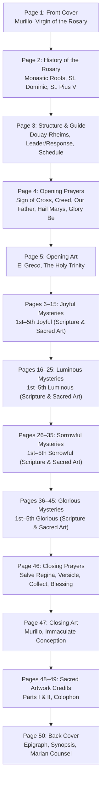

# Pray The Rosary — Source Verification Guide & Book-Order References

---

## AI Agent Verification & Fact-Checking Rules

> [!IMPORTANT]
> **CANONICAL VERIFICATION LEDGER FOR SACRED CONTENT & ARTWORK ATTRIBUTIONS**
> 
> This document (`documents/references.md`) serves as the permanent source guide, doctrinal ledger, and archival verification reference for the **Pray The Rosary** project.
> 
> Because **Pray The Rosary** is both an interactive Godot application and a physical 6" × 9" spiral-bound prayer book, every prayer, historical statement, Scripture verse, spiritual fruit, and master painting must be independently verifiable against authoritative primary sources.

### Rules for AI Agents & Human Contributors

1. **Mandatory Pre-Modification Verification**:
   - Before proposing, implementing, or merging changes to any of the following files:
     - `game/data/prayers.json` (sacred prayers, leader/response formatting, translations)
     - `game/data/mysteries.json` (mysteries, spiritual fruits, Scripture citations and texts)
     - `game/data/book_layout.json` (50-page sequence, historical text, front matter, colophon, back cover)
     - `assets/2D/gimp/attributions.json` (master artwork metadata, inventory numbers, holding institutions)
   - You **MUST** consult this document to verify accuracy against the cited primary sources (Vatican archives, USCCB, Douay-Rheims Bible Online, museum collection catalogs).

2. **Synchronization Requirement**:
   - Any approved addition, alteration, or correction to prayers, Scripture verses, historical summaries, or artwork metadata MUST be simultaneously recorded and cited in this document with verifiable external URLs.
   - Never introduce unsourced prayers, apocryphal citations, or modified artwork attributions without documenting the verified primary sources here.

3. **Strict 50-Page Book Order Organization**:
   - All entries below are structured in **strict book order** from **Page 1 (Front Cover)** through **Page 50 (Back Cover)**.
   - Even pages (Pages 6, 8, ..., 44) correspond to the left-hand Word & Prayer pages (Scripture, fruit, meditation, decade prayers).
   - Odd pages (Pages 7, 9, ..., 45) correspond to the right-hand Sacred Art pages (contemplation masterpiece).
   - Pages 1, 2, 3, 4, 5, 46, 47, 48, 49, and 50 correspond to the cover, front matter, opening/closing spreads, credits, and back cover.

4. **Primary Authority Hierarchy**:
   - **Catholic Liturgy & Doctrine**: Holy See / Vatican Archives (`vatican.va`), Catechism of the Catholic Church (*CCC*), Papal Encyclicals, USCCB (`usccb.org`).
   - **Sacred Scripture**: Douay-Rheims Bible (Challoner Revision, 1749–1752, public domain) via Douay-Rheims Bible Online (`drbo.org`).
   - **Sacred Art**: Holding Museum Official Collection Catalogs (Museo del Prado, Kunsthistorisches Museum, National Gallery London, National Gallery of Art Washington, Gallerie dell'Accademia, Pinacoteca di Brera, Hermitage, MFA Boston, Nelson-Atkins, Princeton University Art Museum) and Wikimedia Commons public-domain archival masters.

---

## 50-Page Book-Order Source References

---

### Page 1 — Front Cover

- **Page Number:** 1 (Front Cover, Recto)
- **Book Title:** Pray the Rosary
- **Subtitle:** A Contemplative Visual Guide to the Twenty Mysteries
- **Sacred Artwork Attribution:**
  - **Artwork ID:** `cover`
  - **Title:** *The Virgin of the Rosary* (*La Virgen del Rosario*)
  - **Artist:** Bartolomé Esteban Murillo (1617–1682)
  - **Creation Date:** c. 1650–1655
  - **Medium & Support:** Oil on canvas
  - **Original Dimensions:** 166 cm × 112 cm
  - **Current Location:** Museo del Prado, Madrid, Spain (Room 016)
  - **Inventory Number:** `P00975`
  - **License:** Public Domain (CC0 / PD-Art)
  - **Local Master File:** `assets/2D/gimp/original_downloads/cover_master_murillo.jpg`
  - **Runtime Texture:** `res://assets/images/cover.webp`
- **Primary Source References:**
  - [Reference 1] Museo del Prado Official Catalog (`P00975`): [Museo del Prado Collection — The Virgin of the Rosary](https://www.museodelprado.es/en/the-collection/art-work/the-virgin-of-the-rosary/66248332-88b6-46c9-a8c1-271c5f9b8c79)
  - [Reference 2] Wikimedia Commons Archival Master: [Wikimedia Commons — File:Murillo, Bartolomé Estéban - The Madonna of the Rosary - Google Art Project.jpg](https://upload.wikimedia.org/wikipedia/commons/9/9b/Murillo%2C_Bartolom%C3%A9_Est%C3%A9ban_-_The_Madonna_of_the_Rosary_-_Google_Art_Project.jpg)

---

### Page 2 — The History of the Holy Rosary

- **Page Number:** 2 (Inside Front Cover, Verso)
- **Heading:** The History of the Holy Rosary
- **Subheading:** Origins of the Gospel Prayer of the Church
- **Doctrinal & Historical Content:**
  1. **Monastic Roots & The Marian Psalter**:
     - *Summary*: In the early centuries, monks prayed all 150 Psalms of David weekly. Lay brothers and faithful who could not read Latin prayed 150 Pater Nosters, and later 150 Ave Marias counted on knotted cords ('Paternosters'), forming the 'Psalter of the Blessed Virgin Mary'.
     - [Reference 1] Catholic Encyclopedia ("The Rosary"): [New Advent — The Rosary](https://www.newadvent.org/cathen/13184b.htm)
     - [Reference 2] Pope St. John Paul II, Apostolic Letter *Rosarium Virginis Mariae* (§1–3, §12): [Vatican Archives — Rosarium Virginis Mariae](https://www.vatican.va/content/john-paul-ii/en/apost_letters/2002/documents/hf_jp-ii_apl_20021016_rosarium-virginis-mariae.html)
  2. **St. Dominic & Preaching the Mysteries**:
     - *Summary*: Tradition holds that Our Lady entrusted the Rosary to St. Dominic de Guzmán (1170–1221) to combat heresy by pairing vocal prayer with quiet meditation on Christ's life, death, and resurrection. Carthusian Dominic of Prussia and Dominican Blessed Alan de la Roche later organized the Marian Psalter into fifteen decades with specific Gospel mysteries.
     - [Reference 1] Pope St. Pius V, Papal Bull *Consueverunt Romani Pontifices* (Sept 17, 1569): [Papal Encyclicals Online — Consueverunt Romani Pontifices](https://www.papalencyclicals.net/pius05/p5consue.htm)
     - [Reference 2] Catholic Encyclopedia ("Feast of the Holy Rosary"): [New Advent — Feast of the Holy Rosary](https://www.newadvent.org/cathen/13188b.htm)
     - [Reference 3] Vatican News (Liturgical Feast of Our Lady of the Rosary & Battle of Lepanto 1571): [Vatican News — Feast of Our Lady of the Rosary](https://www.vaticannews.va/en/liturgical-holidays/feast-of-our-lady-of-the-rosary.html)
  3. **Pope St. Pius V & The Twenty Mysteries**:
     - *Summary*: Pope St. Pius V codified the 15 Joyful, Sorrowful, and Glorious Mysteries in 1569 (*Consueverunt Romani Pontifices*) and established the Feast of Our Lady of Victory in 1571 (renamed Feast of Our Lady of the Rosary in 1573 by Pope Gregory XIII). In 2002, Pope St. John Paul II added the five Luminous Mysteries (Mysteries of Light) in *Rosarium Virginis Mariae*.
     - [Reference 1] Pope St. John Paul II, Apostolic Letter *Rosarium Virginis Mariae* (§19): [Vatican Archives — Rosarium Virginis Mariae §19](https://www.vatican.va/content/john-paul-ii/en/apost_letters/2002/documents/hf_jp-ii_apl_20021016_rosarium-virginis-mariae.html)
     - [Reference 2] Vatican Holy Rosary Overview: [Vatican — The Holy Rosary](https://www.vatican.va/special/rosary/index_rosary.htm)

---

### Page 3 — Structure of the Book & How to Pray

- **Page Number:** 3 (Front Matter, Recto)
- **Heading:** Structure of the Book & How to Pray
- **Subheading:** Praying with Scripture, Prayer, and Sacred Art
- **Content & Guidelines:**
  1. **How This Book Is Organized**:
     - Left Page (Word & Prayer): Mystery title, spiritual fruit, Douay-Rheims Scripture passage, meditation, and complete decade prayers.
     - Right Page (Visual Contemplation): Masterpiece artwork and top header.
     - Six Index Tabs: `O` (Opening Prayers), `J` (Joyful), `L` (Luminous), `S` (Sorrowful), `G` (Glorious), `C` (Closing Prayers).
     - Leader & Group Response: Lines in regular type spoken by the leader; lines in bold spoken by the group together.
     - [Reference 1] Douay-Rheims Bible Online (Public Domain Challoner Revision): [DRBO.org](https://www.drbo.org/)
     - [Reference 2] USCCB "How to Pray the Rosary": [USCCB — How to Pray the Rosary](https://www.usccb.org/how-to-pray-the-rosary)
  2. **Step-by-Step Guide to Praying the Rosary**:
     - Daily 5 Decades (praying the mystery set appointed for the day) vs. Complete 20-Decade Rosary (praying Joyful, Luminous, Sorrowful, and Glorious back-to-back in chronological order).
     - [Reference 1] USCCB "How to Pray the Rosary": [USCCB — How to Pray the Rosary](https://www.usccb.org/how-to-pray-the-rosary)
     - [Reference 2] Vatican Rosary Prayers Guide: [Vatican — Litanie Lauretane & Rosary Prayers](https://www.vatican.va/special/rosary/documents/litanie-lauretane_en.html)
     - [Reference 3] Pope St. John Paul II, *Rosarium Virginis Mariae* (§38): [Vatican Archives — Rosarium Virginis Mariae §38](https://www.vatican.va/content/john-paul-ii/en/apost_letters/2002/documents/hf_jp-ii_apl_20021016_rosarium-virginis-mariae.html)
  3. **Weekly Schedule of the Mysteries**:
     - Joyful: Monday & Saturday (and Sundays of Advent and Christmas)
     - Luminous: Thursday
     - Sorrowful: Tuesday & Friday (and Sundays of Lent)
     - Glorious: Wednesday & Sunday (Easter and Ordinary Time)
     - [Reference 1] Pope St. John Paul II, *Rosarium Virginis Mariae* (§38): [Vatican Archives — Rosarium Virginis Mariae §38](https://www.vatican.va/content/john-paul-ii/en/apost_letters/2002/documents/hf_jp-ii_apl_20021016_rosarium-virginis-mariae.html)
     - [Reference 2] USCCB Rosary Schedule: [USCCB — How to Pray the Rosary](https://www.usccb.org/how-to-pray-the-rosary)

---

### Page 4 — The Opening Prayers

- **Page Number:** 4 (Verso, Tab O)
- **Heading:** The Opening Prayers
- **Subheading:** Entering into the Presence of the Most Holy Trinity
- **Prayers in Sequence:**
  1. **The Sign of the Cross** (`sign_of_the_cross` / *Signum Crucis*):
     - Unison text: *"In the name of the Father, and of the Son, and of the Holy Spirit. Amen."*
  2. **The Apostles' Creed** (`apostles_creed` / *Symbolum Apostolorum*):
     - Leader: *"I believe in God, the Father Almighty..."*
     - Group: *"I believe in the Holy Spirit, the holy Catholic Church..."*
  3. **The Our Father** (`our_father` / *Pater Noster*):
     - Leader: *"Our Father, who art in heaven..."*
     - Group: *"Give us this day our daily bread..."*
  4. **The Hail Mary** (`hail_mary` / *Ave Maria*):
     - Leader: *"Hail Mary, full of grace..."*
     - Group: *"Holy Mary, Mother of God..."*
     - First bead: **First Hail Mary (For an Increase of Faith)** (`hail_mary_faith` / *Ave Maria (Pro Fide)*)
     - Second bead: **Second Hail Mary (For an Increase of Hope)** (`hail_mary_hope` / *Ave Maria (Pro Spe)*)
     - Third bead: **Third Hail Mary (For an Increase of Charity)** (`hail_mary_charity` / *Ave Maria (Pro Caritate)*)
  5. **The Glory Be** (`glory_be` / *Gloria Patri*):
     - Leader: *"Glory be to the Father, and to the Son, and to the Holy Spirit,"*
     - Group: *"as it was in the beginning, is now, and ever shall be, world without end. Amen."*
- **Primary Source References:**
  - [Reference 1] USCCB "How to Pray the Rosary": [USCCB — How to Pray the Rosary](https://www.usccb.org/how-to-pray-the-rosary)
  - [Reference 2] Vatican *Compendium of the Catechism of the Catholic Church* Appendix A "Common Prayers": [Vatican Archives — Compendium of the CCC](https://www.vatican.va/archive/compendium_ccc/documents/archive_2005_compendium-ccc_en.html)
  - [Reference 3] Vatican Holy Rosary Prayers: [Vatican — Litanie Lauretane & Rosary Prayers](https://www.vatican.va/special/rosary/documents/litanie-lauretane_en.html)
  - [Reference 4] Catechism of the Catholic Church (*CCC* §184–§197 Apostles' Creed, §1812–§1829 Theological Virtues, §2759–§2865 The Lord's Prayer): [Vatican Archives — Catechism of the Catholic Church](https://www.vatican.va/archive/ENG0015/_INDEX.HTM)

---

### Page 5 — Opening Prayers Artwork

- **Page Number:** 5 (Recto)
- **Heading:** The Opening Prayers
- **Subheading:** The Most Holy Trinity
- **Sacred Artwork Attribution:**
  - **Artwork ID:** `opening_prayers`
  - **Title:** *The Holy Trinity* (*La Trinidad*)
  - **Artist:** El Greco (Doménikos Theotokópoulos, 1541–1614)
  - **Creation Date:** 1577–1579
  - **Medium & Support:** Oil on canvas
  - **Original Dimensions:** 300 cm × 179 cm
  - **Current Location:** Museo del Prado, Madrid, Spain (Room 009B)
  - **Inventory Number:** `P00824`
  - **License:** Public Domain (CC0 / PD-Art)
  - **Local Master File:** `assets/2D/gimp/original_downloads/opening_master_el_greco_trinity.jpg`
  - **Runtime Texture:** `res://assets/images/opening_prayers.webp`
- **Primary Source References:**
  - [Reference 1] Museo del Prado Official Catalog (`P00824`): [Museo del Prado Collection — The Holy Trinity](https://www.museodelprado.es/en/the-collection/art-work/the-holy-trinity/81643c13-a745-4221-8e9a-7517c2f1f0a4)
  - [Reference 2] Wikimedia Commons Archival Master: [Wikimedia Commons — File:La Trinidad (El Greco, 1577-1579).jpg](https://upload.wikimedia.org/wikipedia/commons/f/fe/La_Trinidad_%28El_Greco%2C_1577-1579%29.jpg)

---

### Page 6 — The First Joyful Mystery: The Annunciation

- **Page Number:** 6 (Verso, Tab J)
- **Mystery ID:** `joyful_1_annunciation`
- **Mystery Title:** The Annunciation
- **Spiritual Fruit:** Humility
- **Scripture Citation:** Luke 1:28, 38 (Douay-Rheims)
- **Scripture Text:** *"And the angel being come in, said unto her: Hail, full of grace, the Lord is with thee: blessed art thou among women... And Mary said: Behold the handmaid of the Lord; be it done to me according to thy word."*
- **Meditation:** With humble surrender, the Blessed Virgin welcomes the Archangel Gabriel's message and conceives the Eternal Word by the overshadowing of the Holy Spirit.
- **Decade Prayers:**
  - Our Father (`our_father`)
  - 10× Hail Mary (`hail_mary`)
  - Glory Be (`glory_be`)
  - The Fatima Prayer (`fatima_prayer` / *Oratio Fatimae*): *"O my Jesus, forgive us our sins, save us from the fires of hell, lead all souls to Heaven, especially those most in need of Thy mercy. Amen."*
- **Primary Source References:**
  - [Reference 1] Douay-Rheims Bible Online (Luke 1): [DRBO.org — Luke 1](https://www.drbo.org/chapter/49001.htm) and [New Advent — Luke 1](https://www.newadvent.org/bible/luk001.htm)
  - [Reference 2] Pope St. John Paul II, *Rosarium Virginis Mariae* (§20): [Vatican Archives — Rosarium Virginis Mariae §20](https://www.vatican.va/content/john-paul-ii/en/apost_letters/2002/documents/hf_jp-ii_apl_20021016_rosarium-virginis-mariae.html) and [USCCB — Joyful Mysteries](https://www.usccb.org/how-to-pray-the-rosary)
  - [Reference 3] Vatican Congregation for the Doctrine of the Faith, *The Message of Fatima* (Fatima Prayer origin July 13, 1917): [Vatican CDF — The Message of Fatima](https://www.vatican.va/roman_curia/congregations/cfaith/documents/rc_con_cfaith_doc_20000626_message-fatima_en.html)

---

### Page 7 — First Joyful Mystery Artwork

- **Page Number:** 7 (Recto)
- **Heading:** The First Joyful Mystery
- **Subheading:** The Annunciation
- **Sacred Artwork Attribution:**
  - **Artwork ID:** `joyful_1_annunciation`
  - **Title:** *The Annunciation* (*La Anunciación*)
  - **Artist:** Bartolomé Esteban Murillo (1617–1682)
  - **Creation Date:** c. 1660
  - **Medium & Support:** Oil on canvas
  - **Original Dimensions:** 125 cm × 103 cm
  - **Current Location:** Museo del Prado, Madrid, Spain
  - **Inventory Number:** `P00970`
  - **License:** Public Domain (CC0 / PD-Art)
  - **Local Master File:** `assets/2D/gimp/original_downloads/joyful_1_annunciation_master_murillo.jpg`
  - **Runtime Texture:** `res://assets/images/joyful_1_annunciation.webp`
- **Primary Source References:**
  - [Reference 1] Museo del Prado Official Catalog (`P00970`): [Museo del Prado Collection — The Annunciation](https://www.museodelprado.es/en/the-collection/art-work/the-annunciation/31bc7855-879e-43ee-8ec1-fa89ffb5e28a)
  - [Reference 2] Wikimedia Commons Archival Master: [Wikimedia Commons — File:Bartolome murillo-anunciacion.jpg](https://upload.wikimedia.org/wikipedia/commons/b/b9/Bartolome_murillo-anunciacion.jpg)

---

### Page 8 — The Second Joyful Mystery: The Visitation

- **Page Number:** 8 (Verso)
- **Mystery ID:** `joyful_2_visitation`
- **Mystery Title:** The Visitation
- **Spiritual Fruit:** Love of Neighbor
- **Scripture Citation:** Luke 1:41–42, 46–47 (Douay-Rheims)
- **Scripture Text:** *"And it came to pass, that when Elizabeth heard the salutation of Mary, the infant leaped in her womb. And Elizabeth was filled with the Holy Ghost: And she cried out with a loud voice, and said: Blessed art thou among women, and blessed is the fruit of thy womb... And Mary said: My soul doth magnify the Lord. And my spirit hath rejoiced in God my Saviour."*
- **Meditation:** Bearing Christ within her, Mary hastens in charity to serve her cousin Elizabeth, bringing sanctifying joy to the unborn John the Baptist.
- **Decade Prayers:** Our Father (`our_father`), 10× Hail Mary (`hail_mary`), Glory Be (`glory_be`), Fatima Prayer (`fatima_prayer`).
- **Primary Source References:**
  - [Reference 1] Douay-Rheims Bible Online (Luke 1): [DRBO.org — Luke 1](https://www.drbo.org/chapter/49001.htm) and [New Advent — Luke 1](https://www.newadvent.org/bible/luk001.htm)
  - [Reference 2] Pope St. John Paul II, *Rosarium Virginis Mariae* (§20): [Vatican Archives — Rosarium Virginis Mariae §20](https://www.vatican.va/content/john-paul-ii/en/apost_letters/2002/documents/hf_jp-ii_apl_20021016_rosarium-virginis-mariae.html) and [USCCB — Joyful Mysteries](https://www.usccb.org/how-to-pray-the-rosary)
  - [Reference 3] Vatican CDF *The Message of Fatima*: [Vatican CDF — The Message of Fatima](https://www.vatican.va/roman_curia/congregations/cfaith/documents/rc_con_cfaith_doc_20000626_message-fatima_en.html)

---

### Page 9 — Second Joyful Mystery Artwork

- **Page Number:** 9 (Recto)
- **Heading:** The Second Joyful Mystery
- **Subheading:** The Visitation
- **Sacred Artwork Attribution:**
  - **Artwork ID:** `joyful_2_visitation`
  - **Title:** *The Visitation*
  - **Artist:** Philippe de Champaigne (1602–1674)
  - **Creation Date:** c. 1643–1648
  - **Medium & Support:** Oil on canvas
  - **Original Dimensions:** 114.5 cm × 88.5 cm
  - **Current Location:** Princeton University Art Museum, Princeton, New Jersey
  - **Inventory Number:** `y1994-17`
  - **License:** Public Domain (CC0 / PD-Art)
  - **Local Master File:** `assets/2D/gimp/original_downloads/joyful_2_visitation_master_champaigne.jpg`
  - **Runtime Texture:** `res://assets/images/joyful_2_visitation.webp`
- **Primary Source References:**
  - [Reference 1] Princeton University Art Museum Official Catalog (`y1994-17`): [Princeton Art Museum — The Visitation](https://artmuseum.princeton.edu/collections/objects/30672)
  - [Reference 2] Wikimedia Commons Archival Master: [Wikimedia Commons — File:Philippe de Champaigne - The Visitation - y1994-17 - Princeton University Art Museum.jpg](https://upload.wikimedia.org/wikipedia/commons/c/c8/Philippe_de_Champaigne_-_The_Visitation_-_y1994-17_-_Princeton_University_Art_Museum.jpg)

---

### Page 10 — The Third Joyful Mystery: The Nativity of Our Lord

- **Page Number:** 10 (Verso)
- **Mystery ID:** `joyful_3_nativity`
- **Mystery Title:** The Nativity of Our Lord
- **Spiritual Fruit:** Poverty of Spirit and Detachment from the World
- **Scripture Citation:** Luke 2:6–7, 10–11 (Douay-Rheims)
- **Scripture Text:** *"And it came to pass, that when they were there, her days were accomplished, that she should be delivered. And she brought forth her firstborn son, and wrapped him up in swaddling clothes, and laid him in a manger; because there was no room for them in the inn... Behold, I bring you good tidings of great joy, that shall be to all the people: For, this day, is born to you a Saviour, who is Christ the Lord, in the city of David."*
- **Meditation:** In the stillness of Bethlehem's night, the Light of the World is born in humble poverty, adored by Mary, Joseph, the angels, and the simple shepherds.
- **Decade Prayers:** Our Father (`our_father`), 10× Hail Mary (`hail_mary`), Glory Be (`glory_be`), Fatima Prayer (`fatima_prayer`).
- **Primary Source References:**
  - [Reference 1] Douay-Rheims Bible Online (Luke 2): [DRBO.org — Luke 2](https://www.drbo.org/chapter/49002.htm) and [New Advent — Luke 2](https://www.newadvent.org/bible/luk002.htm)
  - [Reference 2] Pope St. John Paul II, *Rosarium Virginis Mariae* (§20): [Vatican Archives — Rosarium Virginis Mariae §20](https://www.vatican.va/content/john-paul-ii/en/apost_letters/2002/documents/hf_jp-ii_apl_20021016_rosarium-virginis-mariae.html) and [USCCB — Joyful Mysteries](https://www.usccb.org/how-to-pray-the-rosary)
  - [Reference 3] Vatican CDF *The Message of Fatima*: [Vatican CDF — The Message of Fatima](https://www.vatican.va/roman_curia/congregations/cfaith/documents/rc_con_cfaith_doc_20000626_message-fatima_en.html)

---

### Page 11 — Third Joyful Mystery Artwork

- **Page Number:** 11 (Recto)
- **Heading:** The Third Joyful Mystery
- **Subheading:** The Nativity of Our Lord
- **Sacred Artwork Attribution:**
  - **Artwork ID:** `joyful_3_nativity`
  - **Title:** *The Adoration of the Shepherds*
  - **Artist:** Guido Reni (1575–1642)
  - **Creation Date:** c. 1640
  - **Medium & Support:** Oil on canvas
  - **Original Dimensions:** 480 cm × 321 cm
  - **Current Location:** National Gallery, London, United Kingdom
  - **Inventory Number:** `NG6270`
  - **License:** Public Domain (CC0 / PD-Art)
  - **Local Master File:** `assets/2D/gimp/original_downloads/joyful_3_nativity_master_guido_reni.jpg`
  - **Runtime Texture:** `res://assets/images/joyful_3_nativity.webp`
- **Primary Source References:**
  - [Reference 1] National Gallery London Official Catalog (`NG6270`): [National Gallery London — The Adoration of the Shepherds](https://www.nationalgallery.org.uk/paintings/guido-reni-the-adoration-of-the-shepherds)
  - [Reference 2] Wikimedia Commons Archival Master: [Wikimedia Commons — File:The Adoration of the Shepherds by Guido Reni.jpg](https://upload.wikimedia.org/wikipedia/commons/4/4e/The_Adoration_of_the_Shepherds_by_Guido_Reni.jpg)

---

### Page 12 — The Fourth Joyful Mystery: The Presentation of Jesus in the Temple

- **Page Number:** 12 (Verso)
- **Mystery ID:** `joyful_4_presentation`
- **Mystery Title:** The Presentation of Jesus in the Temple
- **Spiritual Fruit:** Obedience and Purity
- **Scripture Citation:** Luke 2:22, 28–32 (Douay-Rheims)
- **Scripture Text:** *"And after the days of her purification, according to the law of Moses, were accomplished, they carried him to Jerusalem, to present him to the Lord... [Then Simeon] took him into his arms, and blessed God, and said: Now thou dost dismiss thy servant, O Lord, according to thy word in peace; Because my eyes have seen thy salvation, Which thou hast prepared before the face of all peoples: A light to the revelation of the Gentiles, and the glory of thy people Israel."*
- **Meditation:** In loving obedience to the Law of the Lord, Mary and Joseph offer the Infant Jesus in the Temple, where righteous Simeon recognizes the promised Redeemer.
- **Decade Prayers:** Our Father (`our_father`), 10× Hail Mary (`hail_mary`), Glory Be (`glory_be`), Fatima Prayer (`fatima_prayer`).
- **Primary Source References:**
  - [Reference 1] Douay-Rheims Bible Online (Luke 2): [DRBO.org — Luke 2](https://www.drbo.org/chapter/49002.htm) and [New Advent — Luke 2](https://www.newadvent.org/bible/luk002.htm)
  - [Reference 2] Pope St. John Paul II, *Rosarium Virginis Mariae* (§20): [Vatican Archives — Rosarium Virginis Mariae §20](https://www.vatican.va/content/john-paul-ii/en/apost_letters/2002/documents/hf_jp-ii_apl_20021016_rosarium-virginis-mariae.html) and [USCCB — Joyful Mysteries](https://www.usccb.org/how-to-pray-the-rosary)
  - [Reference 3] Vatican CDF *The Message of Fatima*: [Vatican CDF — The Message of Fatima](https://www.vatican.va/roman_curia/congregations/cfaith/documents/rc_con_cfaith_doc_20000626_message-fatima_en.html)

---

### Page 13 — Fourth Joyful Mystery Artwork

- **Page Number:** 13 (Recto)
- **Heading:** The Fourth Joyful Mystery
- **Subheading:** The Presentation of Jesus in the Temple
- **Sacred Artwork Attribution:**
  - **Artwork ID:** `joyful_4_presentation`
  - **Title:** *Presentation of Jesus in the Temple*
  - **Artist:** Vittore Carpaccio (c. 1465–1525/1526)
  - **Creation Date:** 1510
  - **Medium & Support:** Tempera and oil on panel
  - **Original Dimensions:** 421 cm × 236 cm
  - **Current Location:** Gallerie dell'Accademia, Venice, Italy
  - **Inventory Number:** `Cat. 44`
  - **License:** Public Domain (CC0 / PD-Art)
  - **Local Master File:** `assets/2D/gimp/original_downloads/joyful_4_presentation_master_carpaccio.jpg`
  - **Runtime Texture:** `res://assets/images/joyful_4_presentation.webp`
- **Primary Source References:**
  - [Reference 1] Gallerie dell'Accademia Venice Official Catalog: [Gallerie dell'Accademia — Presentazione di Gesù al tempio](https://www.gallerieaccademia.it/presentazione-di-gesu-al-tempio)
  - [Reference 2] Wikimedia Commons Archival Master: [Wikimedia Commons — File:Accademia - Presentation of Jesus in the Temple by Vittore Carpaccio Cat.44.jpg](https://upload.wikimedia.org/wikipedia/commons/1/10/Accademia_-_Presentation_of_Jesus_in_the_Temple_by_Vittore_Carpaccio_Cat.44.jpg)

---

### Page 14 — The Fifth Joyful Mystery: The Finding of Jesus in the Temple

- **Page Number:** 14 (Verso)
- **Mystery ID:** `joyful_5_finding_in_temple`
- **Mystery Title:** The Finding of Jesus in the Temple
- **Spiritual Fruit:** Joy in Finding Jesus and True Piety
- **Scripture Citation:** Luke 2:46–47, 49, 51 (Douay-Rheims)
- **Scripture Text:** *"And it came to pass, that, after three days, they found him in the temple, sitting in the midst of the doctors, hearing them, and asking them questions. And all that heard him were astonished at his wisdom and his answers... And he said to them: How is it that you sought me? did you not know, that I must be about my father's business?... And his mother kept all these words in her heart."*
- **Meditation:** After three days of sorrowful searching, Mary and Joseph rejoice to find the twelve-year-old Jesus in His Father's house, illuminating the teachers of Israel with divine wisdom.
- **Decade Prayers:** Our Father (`our_father`), 10× Hail Mary (`hail_mary`), Glory Be (`glory_be`), Fatima Prayer (`fatima_prayer`).
- **Primary Source References:**
  - [Reference 1] Douay-Rheims Bible Online (Luke 2): [DRBO.org — Luke 2](https://www.drbo.org/chapter/49002.htm) and [New Advent — Luke 2](https://www.newadvent.org/bible/luk002.htm)
  - [Reference 2] Pope St. John Paul II, *Rosarium Virginis Mariae* (§20): [Vatican Archives — Rosarium Virginis Mariae §20](https://www.vatican.va/content/john-paul-ii/en/apost_letters/2002/documents/hf_jp-ii_apl_20021016_rosarium-virginis-mariae.html) and [USCCB — Joyful Mysteries](https://www.usccb.org/how-to-pray-the-rosary)
  - [Reference 3] Vatican CDF *The Message of Fatima*: [Vatican CDF — The Message of Fatima](https://www.vatican.va/roman_curia/congregations/cfaith/documents/rc_con_cfaith_doc_20000626_message-fatima_en.html)

---

### Page 15 — Fifth Joyful Mystery Artwork

- **Page Number:** 15 (Recto)
- **Heading:** The Fifth Joyful Mystery
- **Subheading:** The Finding of Jesus in the Temple
- **Sacred Artwork Attribution:**
  - **Artwork ID:** `joyful_5_finding_in_temple`
  - **Title:** *Christ among the Doctors*
  - **Artist:** Bernard van Orley (c. 1487–1541)
  - **Creation Date:** c. 1513
  - **Medium & Support:** Oil on panel
  - **Original Dimensions:** 53.7 cm × 32.3 cm
  - **Current Location:** National Gallery of Art, Washington, D.C.
  - **Inventory Number:** `1952.5.47.a (NGA 41661)`
  - **License:** Public Domain (CC0 / Open Access)
  - **Local Master File:** `assets/2D/gimp/original_downloads/joyful_5_finding_in_temple_master_van_orley.jpg`
  - **Runtime Texture:** `res://assets/images/joyful_5_finding_in_temple.webp`
- **Primary Source References:**
  - [Reference 1] National Gallery of Art Washington Official Catalog (`1952.5.47.a`): [NGA Washington — Christ among the Doctors](https://www.nga.gov/collection/art-object-page.41661.html)
  - [Reference 2] Wikimedia Commons Archival Master: [Wikimedia Commons — File:Bernard van Orley, Christ among the Doctors (obverse), c. 1513, NGA 41661.jpg](https://upload.wikimedia.org/wikipedia/commons/0/05/Bernard_van_Orley%2C_Christ_among_the_Doctors_%28obverse%29%2C_c._1513%2C_NGA_41661.jpg)

---

### Page 16 — The First Luminous Mystery: The Baptism of Jesus in the Jordan

- **Page Number:** 16 (Verso, Tab L)
- **Mystery ID:** `luminous_1_baptism`
- **Mystery Title:** The Baptism of Jesus in the Jordan
- **Spiritual Fruit:** Openness to the Holy Spirit
- **Scripture Citation:** Matthew 3:16–17 (Douay-Rheims)
- **Scripture Text:** *"And Jesus being baptized, forthwith came out of the water: and lo, the heavens were opened to him: and he saw the Spirit of God descending as a dove, and coming upon him. And behold a voice from heaven, saying: This is my beloved Son, in whom I am well pleased."*
- **Meditation:** Descending into the waters of the Jordan to sanctify them, Christ is anointed by the Holy Spirit and proclaimed the Beloved Son of the Eternal Father.
- **Decade Prayers:** Our Father (`our_father`), 10× Hail Mary (`hail_mary`), Glory Be (`glory_be`), Fatima Prayer (`fatima_prayer`).
- **Primary Source References:**
  - [Reference 1] Douay-Rheims Bible Online (Matthew 3): [DRBO.org — Matthew 3](https://www.drbo.org/chapter/47003.htm) and [New Advent — Matthew 3](https://www.newadvent.org/bible/mat003.htm)
  - [Reference 2] Pope St. John Paul II, *Rosarium Virginis Mariae* (§21): [Vatican Archives — Rosarium Virginis Mariae §21](https://www.vatican.va/content/john-paul-ii/en/apost_letters/2002/documents/hf_jp-ii_apl_20021016_rosarium-virginis-mariae.html) and [USCCB — Luminous Mysteries](https://www.usccb.org/how-to-pray-the-rosary)
  - [Reference 3] Vatican CDF *The Message of Fatima*: [Vatican CDF — The Message of Fatima](https://www.vatican.va/roman_curia/congregations/cfaith/documents/rc_con_cfaith_doc_20000626_message-fatima_en.html)

---

### Page 17 — First Luminous Mystery Artwork

- **Page Number:** 17 (Recto)
- **Heading:** The First Luminous Mystery
- **Subheading:** The Baptism of Jesus in the Jordan
- **Sacred Artwork Attribution:**
  - **Artwork ID:** `luminous_1_baptism`
  - **Title:** *The Baptism of Christ*
  - **Artist:** Guido Reni (1575–1642)
  - **Creation Date:** c. 1622–1623
  - **Medium & Support:** Oil on canvas
  - **Original Dimensions:** 263.5 cm × 186.5 cm
  - **Current Location:** Kunsthistorisches Museum, Vienna, Austria
  - **Inventory Number:** `GG 222`
  - **License:** Public Domain (CC0 / Google Art Project)
  - **Local Master File:** `assets/2D/gimp/original_downloads/luminous_1_baptism_master_guido_reni.jpg`
  - **Runtime Texture:** `res://assets/images/luminous_1_baptism.webp`
- **Primary Source References:**
  - [Reference 1] Kunsthistorisches Museum Vienna Official Catalog (`GG 222`): [KHM Vienna — The Baptism of Christ](https://www.khm.at/objektdb/detail/1531/)
  - [Reference 2] Wikimedia Commons Archival Master: [Wikimedia Commons — File:Guido Reni - The Baptism of Christ - Google Art Project.jpg](https://commons.wikimedia.org/wiki/File:Guido_Reni_-_The_Baptism_of_Christ_-_Google_Art_Project.jpg)

---

### Page 18 — The Second Luminous Mystery: The Wedding Feast at Cana

- **Page Number:** 18 (Verso)
- **Mystery ID:** `luminous_2_wedding_at_cana`
- **Mystery Title:** The Wedding Feast at Cana
- **Spiritual Fruit:** To Jesus through Mary
- **Scripture Citation:** John 2:3–5, 11 (Douay-Rheims)
- **Scripture Text:** *"And the wine failing, the mother of Jesus saith to him: They have no wine. And Jesus saith to her: Woman, what is that to me and to thee? my hour is not yet come. His mother saith to the waiters: Whatsoever he shall say to you, do ye... This beginning of miracles did Jesus in Cana of Galilee; and manifested his glory, and his disciples believed in him."*
- **Meditation:** At the compassionate intercession of His Mother, Christ changes water into the choicest wine, awakening faith in the hearts of His disciples.
- **Decade Prayers:** Our Father (`our_father`), 10× Hail Mary (`hail_mary`), Glory Be (`glory_be`), Fatima Prayer (`fatima_prayer`).
- **Primary Source References:**
  - [Reference 1] Douay-Rheims Bible Online (John 2): [DRBO.org — John 2](https://www.drbo.org/chapter/50002.htm) and [New Advent — John 2](https://www.newadvent.org/bible/joh002.htm)
  - [Reference 2] Pope St. John Paul II, *Rosarium Virginis Mariae* (§21): [Vatican Archives — Rosarium Virginis Mariae §21](https://www.vatican.va/content/john-paul-ii/en/apost_letters/2002/documents/hf_jp-ii_apl_20021016_rosarium-virginis-mariae.html) and [USCCB — Luminous Mysteries](https://www.usccb.org/how-to-pray-the-rosary)
  - [Reference 3] Vatican CDF *The Message of Fatima*: [Vatican CDF — The Message of Fatima](https://www.vatican.va/roman_curia/congregations/cfaith/documents/rc_con_cfaith_doc_20000626_message-fatima_en.html)

---

### Page 19 — Second Luminous Mystery Artwork

- **Page Number:** 19 (Recto)
- **Heading:** The Second Luminous Mystery
- **Subheading:** The Wedding Feast at Cana
- **Sacred Artwork Attribution:**
  - **Artwork ID:** `luminous_2_wedding_at_cana`
  - **Title:** *The Marriage at Cana*
  - **Artist:** Sebastiano Ricci (1659–1734)
  - **Creation Date:** c. 1712–1715
  - **Medium & Support:** Oil on canvas
  - **Original Dimensions:** 166.4 cm × 137.2 cm
  - **Current Location:** Nelson-Atkins Museum of Art, Kansas City, Missouri
  - **Inventory Number:** `59-2`
  - **License:** Public Domain (CC0 / PD-Art)
  - **Local Master File:** `assets/2D/gimp/original_downloads/luminous_2_wedding_at_cana_master_ricci.jpg`
  - **Runtime Texture:** `res://assets/images/luminous_2_wedding_at_cana.webp`
- **Primary Source References:**
  - [Reference 1] Nelson-Atkins Museum of Art Official Catalog (`59-2`): [Nelson-Atkins Collection — The Marriage at Cana](https://art.nelson-atkins.org/objects/10207/the-marriage-at-cana)
  - [Reference 2] Wikimedia Commons Archival Master: [Wikimedia Commons — File:Sebastiano Ricci 043.jpg](https://commons.wikimedia.org/wiki/File:Sebastiano_Ricci_043.jpg)

---

### Page 20 — The Third Luminous Mystery: The Proclamation of the Kingdom of God

- **Page Number:** 20 (Verso)
- **Mystery ID:** `luminous_3_proclamation`
- **Mystery Title:** The Proclamation of the Kingdom of God
- **Spiritual Fruit:** Repentance and Trust in God
- **Scripture Citation:** Mark 1:14–15; Matthew 5:3, 8 (Douay-Rheims)
- **Scripture Text:** *"Jesus came into Galilee, preaching the gospel of the kingdom of God, And saying: The time is accomplished, and the kingdom of God is at hand: repent, and believe the gospel... Blessed are the poor in spirit: for theirs is the kingdom of heaven... Blessed are the clean of heart: for they shall see God."*
- **Meditation:** Upon the Galilean hillside, Christ proclaims the Beatitudes, calling every soul to conversion of heart, merciful forgiveness, and filial trust in the Father.
- **Decade Prayers:** Our Father (`our_father`), 10× Hail Mary (`hail_mary`), Glory Be (`glory_be`), Fatima Prayer (`fatima_prayer`).
- **Primary Source References:**
  - [Reference 1] Douay-Rheims Bible Online (Mark 1 & Matthew 5): [DRBO.org — Mark 1](https://www.drbo.org/chapter/48001.htm) & [DRBO.org — Matthew 5](https://www.drbo.org/chapter/47005.htm), and [New Advent — Mark 1](https://www.newadvent.org/bible/mar001.htm)
  - [Reference 2] Pope St. John Paul II, *Rosarium Virginis Mariae* (§21): [Vatican Archives — Rosarium Virginis Mariae §21](https://www.vatican.va/content/john-paul-ii/en/apost_letters/2002/documents/hf_jp-ii_apl_20021016_rosarium-virginis-mariae.html) and [USCCB — Luminous Mysteries](https://www.usccb.org/how-to-pray-the-rosary)
  - [Reference 3] Vatican CDF *The Message of Fatima*: [Vatican CDF — The Message of Fatima](https://www.vatican.va/roman_curia/congregations/cfaith/documents/rc_con_cfaith_doc_20000626_message-fatima_en.html)

---

### Page 21 — Third Luminous Mystery Artwork

- **Page Number:** 21 (Recto)
- **Heading:** The Third Luminous Mystery
- **Subheading:** The Proclamation of the Kingdom of God
- **Sacred Artwork Attribution:**
  - **Artwork ID:** `luminous_3_proclamation`
  - **Title:** *The Sermon on the Mount*
  - **Artist:** Carl Bloch (1834–1890)
  - **Creation Date:** 1877
  - **Medium & Support:** Oil on copper
  - **Original Dimensions:** 104 cm × 92 cm
  - **Current Location:** Museum of National History, Frederiksborg Castle, Hillerød, Denmark
  - **Inventory Number:** `King's Oratory (Kongens Bedekammer)`
  - **License:** Public Domain (CC0 / PD-Art)
  - **Local Master File:** `assets/2D/gimp/original_downloads/luminous_3_proclamation_master_carl_bloch.jpg`
  - **Runtime Texture:** `res://assets/images/luminous_3_proclamation.webp`
- **Primary Source References:**
  - [Reference 1] Museum of National History Frederiksborg Castle Carl Bloch Collection: [Frederiksborg Castle Museum](https://dnm.dk/)
  - [Reference 2] Wikimedia Commons Archival Master: [Wikimedia Commons — File:Bloch-SermonOnTheMount.jpg](https://commons.wikimedia.org/wiki/File:Bloch-SermonOnTheMount.jpg)

---

### Page 22 — The Fourth Luminous Mystery: The Transfiguration

- **Page Number:** 22 (Verso)
- **Mystery ID:** `luminous_4_transfiguration`
- **Mystery Title:** The Transfiguration
- **Spiritual Fruit:** Desire for Holiness
- **Scripture Citation:** Luke 9:29–31, 35 (Douay-Rheims)
- **Scripture Text:** *"And whilst he prayed, the shape of his countenance was altered, and his raiment became white and glittering. And behold two men were talking with him. And they were Moses and Elias, appearing in majesty... And a voice came out of the cloud, saying: This is my beloved Son; hear him."*
- **Meditation:** On Mount Tabor, the glory of the Godhead shines forth from the face of Christ, strengthening His Apostles for the coming Passion and revealing our call to transfiguring grace.
- **Decade Prayers:** Our Father (`our_father`), 10× Hail Mary (`hail_mary`), Glory Be (`glory_be`), Fatima Prayer (`fatima_prayer`).
- **Primary Source References:**
  - [Reference 1] Douay-Rheims Bible Online (Luke 9): [DRBO.org — Luke 9](https://www.drbo.org/chapter/49009.htm) and [New Advent — Luke 9](https://www.newadvent.org/bible/luk009.htm)
  - [Reference 2] Pope St. John Paul II, *Rosarium Virginis Mariae* (§21): [Vatican Archives — Rosarium Virginis Mariae §21](https://www.vatican.va/content/john-paul-ii/en/apost_letters/2002/documents/hf_jp-ii_apl_20021016_rosarium-virginis-mariae.html) and [USCCB — Luminous Mysteries](https://www.usccb.org/how-to-pray-the-rosary)
  - [Reference 3] Vatican CDF *The Message of Fatima*: [Vatican CDF — The Message of Fatima](https://www.vatican.va/roman_curia/congregations/cfaith/documents/rc_con_cfaith_doc_20000626_message-fatima_en.html)

---

### Page 23 — Fourth Luminous Mystery Artwork

- **Page Number:** 23 (Recto)
- **Heading:** The Fourth Luminous Mystery
- **Subheading:** The Transfiguration
- **Sacred Artwork Attribution:**
  - **Artwork ID:** `luminous_4_transfiguration`
  - **Title:** *The Transfiguration of Christ*
  - **Artist:** Gerard David (c. 1460–1523)
  - **Creation Date:** c. 1520
  - **Medium & Support:** Oil on panel
  - **Original Dimensions:** 174 cm × 120 cm
  - **Current Location:** Church of Our Lady (*Onze-Lieve-Vrouwekerk*), Bruges, Belgium
  - **Inventory Number:** `OLV.0003.I`
  - **License:** Public Domain (CC0 / PD-Art)
  - **Local Master File:** `assets/2D/gimp/original_downloads/luminous_4_transfiguration_master_gerard_david.jpg`
  - **Runtime Texture:** `res://assets/images/luminous_4_transfiguration.webp`
- **Primary Source References:**
  - [Reference 1] Musea Brugge / Church of Our Lady Collection: [Musea Brugge — Onze-Lieve-Vrouwekerk](https://www.museabrugge.be/en/visit-our-museums/our-museums-and-monuments/onze-lieve-vrouwekerk)
  - [Reference 2] Wikimedia Commons Archival Master: [Wikimedia Commons — File:Gerard David - The transfiguration.jpg](https://commons.wikimedia.org/wiki/File:Gerard_David_-_The_transfiguration.jpg)

---

### Page 24 — The Fifth Luminous Mystery: The Institution of the Eucharist

- **Page Number:** 24 (Verso)
- **Mystery ID:** `luminous_5_eucharist`
- **Mystery Title:** The Institution of the Eucharist
- **Spiritual Fruit:** Adoration and Gratitude for the Most Blessed Sacrament
- **Scripture Citation:** Matthew 26:26–28 (Douay-Rheims)
- **Scripture Text:** *"And whilst they were at supper, Jesus took bread, and blessed, and broke: and gave to his disciples, and said: Take ye, and eat. This is my body. And taking the chalice, he gave thanks, and gave to them, saying: Drink ye all of this. For this is my blood of the new testament, which shall be shed for many unto remission of sins."*
- **Meditation:** Having loved His own unto the end, Christ offers His Body and Blood under the appearances of bread and wine to remain with His Church forever.
- **Decade Prayers:** Our Father (`our_father`), 10× Hail Mary (`hail_mary`), Glory Be (`glory_be`), Fatima Prayer (`fatima_prayer`).
- **Primary Source References:**
  - [Reference 1] Douay-Rheims Bible Online (Matthew 26): [DRBO.org — Matthew 26](https://www.drbo.org/chapter/47026.htm) and [New Advent — Matthew 26](https://www.newadvent.org/bible/mat026.htm)
  - [Reference 2] Pope St. John Paul II, *Rosarium Virginis Mariae* (§21): [Vatican Archives — Rosarium Virginis Mariae §21](https://www.vatican.va/content/john-paul-ii/en/apost_letters/2002/documents/hf_jp-ii_apl_20021016_rosarium-virginis-mariae.html) and [USCCB — Luminous Mysteries](https://www.usccb.org/how-to-pray-the-rosary)
  - [Reference 3] Vatican CDF *The Message of Fatima*: [Vatican CDF — The Message of Fatima](https://www.vatican.va/roman_curia/congregations/cfaith/documents/rc_con_cfaith_doc_20000626_message-fatima_en.html)

---

### Page 25 — Fifth Luminous Mystery Artwork

- **Page Number:** 25 (Recto)
- **Heading:** The Fifth Luminous Mystery
- **Subheading:** The Institution of the Eucharist
- **Sacred Artwork Attribution:**
  - **Artwork ID:** `luminous_5_eucharist`
  - **Title:** *The Last Supper*
  - **Artist:** Peter Paul Rubens (1577–1640)
  - **Creation Date:** 1631–1632
  - **Medium & Support:** Oil on panel
  - **Original Dimensions:** 304 cm × 250 cm
  - **Current Location:** Pinacoteca di Brera, Milan, Italy
  - **Inventory Number:** `97`
  - **License:** Public Domain (CC0 / PD-Art)
  - **Local Master File:** `assets/2D/gimp/original_downloads/luminous_5_eucharist_master_rubens.jpg`
  - **Runtime Texture:** `res://assets/images/luminous_5_eucharist.webp`
- **Primary Source References:**
  - [Reference 1] Pinacoteca di Brera Official Catalog (`Inv. 97`): [Pinacoteca di Brera Collection — Last Supper](https://pinacotecabrera.org/en/collezione_online/last-supper/)
  - [Reference 2] Wikimedia Commons Archival Master: [Wikimedia Commons — File:Peter Paul Rubens - Last Supper - WGA20255.jpg](https://commons.wikimedia.org/wiki/File:Peter_Paul_Rubens_-_Last_Supper_-_WGA20255.jpg)

---

### Page 26 — The First Sorrowful Mystery: The Agony in the Garden

- **Page Number:** 26 (Verso, Tab S)
- **Mystery ID:** `sorrowful_1_agony`
- **Mystery Title:** The Agony in the Garden
- **Spiritual Fruit:** Contrition for Sin and Conformity to God's Will
- **Scripture Citation:** Luke 22:41–44 (Douay-Rheims)
- **Scripture Text:** *"And he was withdrawn away from them a stone's cast; and kneeling down, he prayed, Saying: Father, if thou wilt, remove this chalice from me: but yet not my will, but thine be done. And there appeared to him an angel from heaven, strengthening him. And being in an agony, he prayed the longer. And his sweat became as drops of blood, trickling down upon the ground."*
- **Meditation:** In the dark stillness of Gethsemane, Christ bears the weight of every human sin, uniting His sacred heart to the Father's redemptive will.
- **Decade Prayers:** Our Father (`our_father`), 10× Hail Mary (`hail_mary`), Glory Be (`glory_be`), Fatima Prayer (`fatima_prayer`).
- **Primary Source References:**
  - [Reference 1] Douay-Rheims Bible Online (Luke 22): [DRBO.org — Luke 22](https://www.drbo.org/chapter/49022.htm) and [New Advent — Luke 22](https://www.newadvent.org/bible/luk022.htm)
  - [Reference 2] Pope St. John Paul II, *Rosarium Virginis Mariae* (§22): [Vatican Archives — Rosarium Virginis Mariae §22](https://www.vatican.va/content/john-paul-ii/en/apost_letters/2002/documents/hf_jp-ii_apl_20021016_rosarium-virginis-mariae.html) and [USCCB — Sorrowful Mysteries](https://www.usccb.org/how-to-pray-the-rosary)
  - [Reference 3] Vatican CDF *The Message of Fatima*: [Vatican CDF — The Message of Fatima](https://www.vatican.va/roman_curia/congregations/cfaith/documents/rc_con_cfaith_doc_20000626_message-fatima_en.html)

---

### Page 27 — First Sorrowful Mystery Artwork

- **Page Number:** 27 (Recto)
- **Heading:** The First Sorrowful Mystery
- **Subheading:** The Agony in the Garden
- **Sacred Artwork Attribution:**
  - **Artwork ID:** `sorrowful_1_agony`
  - **Title:** *Christ on the Mount of Olives* (*Christ's Fear of Death*)
  - **Artist:** Giovanni Battista Caracciolo (Battistello, 1578–1635)
  - **Creation Date:** c. 1615–1617
  - **Medium & Support:** Oil on canvas
  - **Original Dimensions:** 148 cm × 124 cm
  - **Current Location:** Kunsthistorisches Museum, Vienna, Austria
  - **Inventory Number:** `GG F17`
  - **License:** Public Domain (CC0 / Google Art Project)
  - **Local Master File:** `assets/2D/gimp/original_downloads/sorrowful_1_agony_master_caracciolo.jpg`
  - **Runtime Texture:** `res://assets/images/sorrowful_1_agony.webp`
- **Primary Source References:**
  - [Reference 1] Kunsthistorisches Museum Vienna Official Catalog (`GG F17`): [KHM Vienna — Christ on the Mount of Olives](https://www.khm.at/objektdb/detail/403/)
  - [Reference 2] Wikimedia Commons Archival Master: [Wikimedia Commons — File:Giovanni Battista Caracciolo, called Battistello - Christ on the Mount of Olives (Christ’s Fear of Death) - Google Art Project.jpg](https://commons.wikimedia.org/wiki/File:Giovanni_Battista_Caracciolo,_called_Battistello_-_Christ_on_the_Mount_of_Olives_(Christ%E2%80%99s_Fear_of_Death)_-_Google_Art_Project.jpg)

---

### Page 28 — The Second Sorrowful Mystery: The Scourging at the Pillar

- **Page Number:** 28 (Verso)
- **Mystery ID:** `sorrowful_2_scourging`
- **Mystery Title:** The Scourging at the Pillar
- **Spiritual Fruit:** Purity and Mortification of the Senses
- **Scripture Citation:** John 19:1; Isaias (Isaiah) 53:5 (Douay-Rheims)
- **Scripture Text:** *"Then therefore Pilate took Jesus, and scourged him... But he was wounded for our iniquities, he was bruised for our sins: the chastisement of our peace was upon him, and by his bruises we are healed."*
- **Meditation:** Bound to the pillar in silence, the innocent Lamb of God endures cruel blows in reparation for the sins of the flesh and to heal our wounded nature.
- **Decade Prayers:** Our Father (`our_father`), 10× Hail Mary (`hail_mary`), Glory Be (`glory_be`), Fatima Prayer (`fatima_prayer`).
- **Primary Source References:**
  - [Reference 1] Douay-Rheims Bible Online (John 19 & Isaias 53): [DRBO.org — John 19](https://www.drbo.org/chapter/50019.htm) & [DRBO.org — Isaias 53](https://www.drbo.org/chapter/27053.htm), and [New Advent — John 19](https://www.newadvent.org/bible/joh019.htm)
  - [Reference 2] Pope St. John Paul II, *Rosarium Virginis Mariae* (§22): [Vatican Archives — Rosarium Virginis Mariae §22](https://www.vatican.va/content/john-paul-ii/en/apost_letters/2002/documents/hf_jp-ii_apl_20021016_rosarium-virginis-mariae.html) and [USCCB — Sorrowful Mysteries](https://www.usccb.org/how-to-pray-the-rosary)
  - [Reference 3] Vatican CDF *The Message of Fatima*: [Vatican CDF — The Message of Fatima](https://www.vatican.va/roman_curia/congregations/cfaith/documents/rc_con_cfaith_doc_20000626_message-fatima_en.html)

---

### Page 29 — Second Sorrowful Mystery Artwork

- **Page Number:** 29 (Recto)
- **Heading:** The Second Sorrowful Mystery
- **Subheading:** The Scourging at the Pillar
- **Sacred Artwork Attribution:**
  - **Artwork ID:** `sorrowful_2_scourging`
  - **Title:** *The Flagellation of Christ*
  - **Artist:** Peter Paul Rubens (1577–1640)
  - **Creation Date:** c. 1617
  - **Medium & Support:** Oil on panel
  - **Original Dimensions:** 219 cm × 161 cm
  - **Current Location:** St. Paul's Church (*Sint-Pauluskerk*), Antwerp, Belgium
  - **Inventory Number:** `70926`
  - **License:** Public Domain (CC0 / PD-Art)
  - **Local Master File:** `assets/2D/gimp/original_downloads/sorrowful_2_scourging_master_rubens.jpg`
  - **Runtime Texture:** `res://assets/images/sorrowful_2_scourging.webp`
- **Primary Source References:**
  - [Reference 1] St. Paul's Church Antwerp Rosary Cycle Guide: [Sint-Pauluskerk Antwerpen](https://sintpaulusantwerpen.be/)
  - [Reference 2] Wikimedia Commons Archival Master: [Wikimedia Commons — File:De Mysteriën van de Rozenkrans. De geseling van Christus, Peter Paul Rubens, 17de eeuw, Sint-Pauluskerk Antwerpen.jpg](https://commons.wikimedia.org/wiki/File:De_Mysteri%C3%ABn_van_de_Rozenkrans._De_geseling_van_Christus,_Peter_Paul_Rubens,_17de_eeuw,_Sint-Pauluskerk_Antwerpen.jpg)

---

### Page 30 — The Third Sorrowful Mystery: The Crowning with Thorns

- **Page Number:** 30 (Verso)
- **Mystery ID:** `sorrowful_3_crowning_with_thorns`
- **Mystery Title:** The Crowning with Thorns
- **Spiritual Fruit:** Moral Courage and Reign of Christ in Our Hearts
- **Scripture Citation:** Matthew 27:28–30 (Douay-Rheims)
- **Scripture Text:** *"And stripping him, they put a scarlet cloak about him. And platting a crown of thorns, they put it upon his head, and a reed in his right hand. And bowing the knee before him, they mocked him, saying: Hail, King of the Jews. And spitting upon him, they took the reed, and struck his head."*
- **Meditation:** Crowned with sharp thorns and mocked by soldiers, the true King of Kings teaches us meekness and courage when enduring the world's contempt.
- **Decade Prayers:** Our Father (`our_father`), 10× Hail Mary (`hail_mary`), Glory Be (`glory_be`), Fatima Prayer (`fatima_prayer`).
- **Primary Source References:**
  - [Reference 1] Douay-Rheims Bible Online (Matthew 27): [DRBO.org — Matthew 27](https://www.drbo.org/chapter/47027.htm) and [New Advent — Matthew 27](https://www.newadvent.org/bible/mat027.htm)
  - [Reference 2] Pope St. John Paul II, *Rosarium Virginis Mariae* (§22): [Vatican Archives — Rosarium Virginis Mariae §22](https://www.vatican.va/content/john-paul-ii/en/apost_letters/2002/documents/hf_jp-ii_apl_20021016_rosarium-virginis-mariae.html) and [USCCB — Sorrowful Mysteries](https://www.usccb.org/how-to-pray-the-rosary)
  - [Reference 3] Vatican CDF *The Message of Fatima*: [Vatican CDF — The Message of Fatima](https://www.vatican.va/roman_curia/congregations/cfaith/documents/rc_con_cfaith_doc_20000626_message-fatima_en.html)

---

### Page 31 — Third Sorrowful Mystery Artwork

- **Page Number:** 31 (Recto)
- **Heading:** The Third Sorrowful Mystery
- **Subheading:** The Crowning with Thorns
- **Sacred Artwork Attribution:**
  - **Artwork ID:** `sorrowful_3_crowning_with_thorns`
  - **Title:** *Christ Crowned with Thorns* (*La coronación de espinas*)
  - **Artist:** Sir Anthony van Dyck (1599–1641)
  - **Creation Date:** c. 1618–1620
  - **Medium & Support:** Oil on canvas
  - **Original Dimensions:** 225 cm × 197 cm
  - **Current Location:** Museo del Prado, Madrid, Spain
  - **Inventory Number:** `P01474`
  - **License:** Public Domain (CC0 / PD-Art)
  - **Local Master File:** `assets/2D/gimp/original_downloads/sorrowful_3_crowning_with_thorns_master_van_dyck.jpg`
  - **Runtime Texture:** `res://assets/images/sorrowful_3_crowning_with_thorns.webp`
- **Primary Source References:**
  - [Reference 1] Museo del Prado Official Catalog (`P01474`): [Museo del Prado Collection — The Crowning with Thorns](https://www.museodelprado.es/en/the-collection/art-work/the-crowning-with-thorns/1bb2d634-118b-494b-9721-e00f951e44ef)
  - [Reference 2] Wikimedia Commons Archival Master: [Wikimedia Commons — File:Anthonis van Dyck 004.jpg](https://commons.wikimedia.org/wiki/File:Anthonis_van_Dyck_004.jpg)

---

### Page 32 — The Fourth Sorrowful Mystery: The Carrying of the Cross

- **Page Number:** 32 (Verso)
- **Mystery ID:** `sorrowful_4_carrying_cross`
- **Mystery Title:** The Carrying of the Cross
- **Spiritual Fruit:** Patience in Trials
- **Scripture Citation:** John 19:17; Luke 23:26–27 (Douay-Rheims)
- **Scripture Text:** *"And bearing his own cross, he went forth to that place which is called Calvary... And as they led him away, they laid hold of one Simon of Cyrene, coming from the country; and they laid the cross on him to carry after Jesus. And there followed him a great multitude of people, and of women, who bewailed and lamented him."*
- **Meditation:** Falling beneath the heavy wood along the Via Dolorosa, Christ exchanges a look of piercing love with His sorrowful Mother, inviting us to take up our daily cross after Him.
- **Decade Prayers:** Our Father (`our_father`), 10× Hail Mary (`hail_mary`), Glory Be (`glory_be`), Fatima Prayer (`fatima_prayer`).
- **Primary Source References:**
  - [Reference 1] Douay-Rheims Bible Online (John 19 & Luke 23): [DRBO.org — John 19](https://www.drbo.org/chapter/50019.htm) & [DRBO.org — Luke 23](https://www.drbo.org/chapter/49023.htm), and [New Advent — John 19](https://www.newadvent.org/bible/joh019.htm)
  - [Reference 2] Pope St. John Paul II, *Rosarium Virginis Mariae* (§22): [Vatican Archives — Rosarium Virginis Mariae §22](https://www.vatican.va/content/john-paul-ii/en/apost_letters/2002/documents/hf_jp-ii_apl_20021016_rosarium-virginis-mariae.html) and [USCCB — Sorrowful Mysteries](https://www.usccb.org/how-to-pray-the-rosary)
  - [Reference 3] Vatican CDF *The Message of Fatima*: [Vatican CDF — The Message of Fatima](https://www.vatican.va/roman_curia/congregations/cfaith/documents/rc_con_cfaith_doc_20000626_message-fatima_en.html)

---

### Page 33 — Fourth Sorrowful Mystery Artwork

- **Page Number:** 33 (Recto)
- **Heading:** The Fourth Sorrowful Mystery
- **Subheading:** The Carrying of the Cross
- **Sacred Artwork Attribution:**
  - **Artwork ID:** `sorrowful_4_carrying_cross`
  - **Title:** *Christ Falling on the Way to Calvary* (*Lo Spasimo di Sicilia*)
  - **Artist:** Raphael (Raffaello Sanzio, 1483–1520)
  - **Creation Date:** c. 1516–1517
  - **Medium & Support:** Oil on panel transferred to canvas
  - **Original Dimensions:** 318 cm × 229 cm
  - **Current Location:** Museo del Prado, Madrid, Spain
  - **Inventory Number:** `P00298`
  - **License:** Public Domain (CC0 / PD-Art)
  - **Local Master File:** `assets/2D/gimp/original_downloads/sorrowful_4_carrying_cross_master_raphael.jpg`
  - **Runtime Texture:** `res://assets/images/sorrowful_4_carrying_cross.webp`
- **Primary Source References:**
  - [Reference 1] Museo del Prado Official Catalog (`P00298`): [Museo del Prado Collection — Christ Falls on the Way to Calvary](https://www.museodelprado.es/en/the-collection/art-work/christ-falls-on-the-way-to-calvary/82eb0216-0421-4f51-a9f4-6663f72e353b)
  - [Reference 2] Wikimedia Commons Archival Master: [Wikimedia Commons — File:Christ Falling on the Way to Calvary - Raphael.jpg](https://commons.wikimedia.org/wiki/File:Christ_Falling_on_the_Way_to_Calvary_-_Raphael.jpg)

---

### Page 34 — The Fifth Sorrowful Mystery: The Crucifixion and Death of Our Lord

- **Page Number:** 34 (Verso)
- **Mystery ID:** `sorrowful_5_crucifixion`
- **Mystery Title:** The Crucifixion and Death of Our Lord
- **Spiritual Fruit:** Forgiveness of Injuries and Perseverance in Faith
- **Scripture Citation:** Luke 23:33–34, 46 (Douay-Rheims)
- **Scripture Text:** *"And when they were come to the place which is called Calvary, they crucified him there... And Jesus said: Father, forgive them, for they know not what they do... And Jesus crying out with a loud voice, said: Father, into thy hands I commend my spirit. And saying this, he gave up the ghost."*
- **Meditation:** Raised upon the Cross of Calvary, Christ pardons His executioners, entrusts us to His Blessed Mother, and pours forth His last breath for the salvation of souls.
- **Decade Prayers:** Our Father (`our_father`), 10× Hail Mary (`hail_mary`), Glory Be (`glory_be`), Fatima Prayer (`fatima_prayer`).
- **Primary Source References:**
  - [Reference 1] Douay-Rheims Bible Online (Luke 23): [DRBO.org — Luke 23](https://www.drbo.org/chapter/49023.htm) and [New Advent — Luke 23](https://www.newadvent.org/bible/luk023.htm)
  - [Reference 2] Pope St. John Paul II, *Rosarium Virginis Mariae* (§22): [Vatican Archives — Rosarium Virginis Mariae §22](https://www.vatican.va/content/john-paul-ii/en/apost_letters/2002/documents/hf_jp-ii_apl_20021016_rosarium-virginis-mariae.html) and [USCCB — Sorrowful Mysteries](https://www.usccb.org/how-to-pray-the-rosary)
  - [Reference 3] Vatican CDF *The Message of Fatima*: [Vatican CDF — The Message of Fatima](https://www.vatican.va/roman_curia/congregations/cfaith/documents/rc_con_cfaith_doc_20000626_message-fatima_en.html)

---

### Page 35 — Fifth Sorrowful Mystery Artwork

- **Page Number:** 35 (Recto)
- **Heading:** The Fifth Sorrowful Mystery
- **Subheading:** The Crucifixion and Death of Our Lord
- **Sacred Artwork Attribution:**
  - **Artwork ID:** `sorrowful_5_crucifixion`
  - **Title:** *Christ on the Cross* (*Cristo crucificado*)
  - **Artist:** Bartolomé Esteban Murillo (1617–1682)
  - **Creation Date:** c. 1675
  - **Medium & Support:** Oil on canvas
  - **Original Dimensions:** 71 cm × 54 cm
  - **Current Location:** Museo del Prado, Madrid, Spain
  - **Inventory Number:** `P00967`
  - **License:** Public Domain (CC0 / PD-Art)
  - **Local Master File:** `assets/2D/gimp/original_downloads/sorrowful_5_crucifixion_master_murillo.jpg`
  - **Runtime Texture:** `res://assets/images/sorrowful_5_crucifixion.webp`
- **Primary Source References:**
  - [Reference 1] Museo del Prado Official Catalog (`P00967`): [Museo del Prado Collection — Christ on the Cross](https://www.museodelprado.es/en/the-collection/art-work/christ-on-the-cross/04259b3f-1002-4fc9-b690-33431ebf10b7)
  - [Reference 2] Wikimedia Commons Archival Master: [Wikimedia Commons — File:Cristo crucificado (Murillo).jpg](https://commons.wikimedia.org/wiki/File:Cristo_crucificado_(Murillo).jpg)

---

### Page 36 — The First Glorious Mystery: The Resurrection of Our Lord

- **Page Number:** 36 (Verso, Tab G)
- **Mystery ID:** `glorious_1_resurrection`
- **Mystery Title:** The Resurrection of Our Lord
- **Spiritual Fruit:** Lively Faith
- **Scripture Citation:** Mark 16:5–6 (Douay-Rheims)
- **Scripture Text:** *"And entering into the sepulchre, they saw a young man sitting on the right side, clothed with a white robe: and they were astonished. Who saith to them: Be not affrighted; you seek Jesus of Nazareth, who was crucified: he is risen, he is not here, behold the place where they laid him."*
- **Meditation:** At dawn on the third day, Christ bursts the bonds of death and rises in radiant majesty, becoming the firstfruits of eternal life for all who believe in Him.
- **Decade Prayers:** Our Father (`our_father`), 10× Hail Mary (`hail_mary`), Glory Be (`glory_be`), Fatima Prayer (`fatima_prayer`).
- **Primary Source References:**
  - [Reference 1] Douay-Rheims Bible Online (Mark 16): [DRBO.org — Mark 16](https://www.drbo.org/chapter/48016.htm) and [New Advent — Mark 16](https://www.newadvent.org/bible/mar016.htm)
  - [Reference 2] Pope St. John Paul II, *Rosarium Virginis Mariae* (§23): [Vatican Archives — Rosarium Virginis Mariae §23](https://www.vatican.va/content/john-paul-ii/en/apost_letters/2002/documents/hf_jp-ii_apl_20021016_rosarium-virginis-mariae.html) and [USCCB — Glorious Mysteries](https://www.usccb.org/how-to-pray-the-rosary)
  - [Reference 3] Vatican CDF *The Message of Fatima*: [Vatican CDF — The Message of Fatima](https://www.vatican.va/roman_curia/congregations/cfaith/documents/rc_con_cfaith_doc_20000626_message-fatima_en.html)

---

### Page 37 — First Glorious Mystery Artwork

- **Page Number:** 37 (Recto)
- **Heading:** The First Glorious Mystery
- **Subheading:** The Resurrection of Our Lord
- **Sacred Artwork Attribution:**
  - **Artwork ID:** `glorious_1_resurrection`
  - **Title:** *The Resurrection of the Lord* (*La Resurrección del Señor*)
  - **Artist:** Bartolomé Esteban Murillo (1617–1682)
  - **Creation Date:** c. 1650–1660
  - **Medium & Support:** Oil on canvas
  - **Original Dimensions:** 243 cm × 164 cm
  - **Current Location:** Real Academia de Bellas Artes de San Fernando, Madrid, Spain
  - **Inventory Number:** `0641`
  - **License:** Public Domain (CC0 / Google Art Project)
  - **Local Master File:** `assets/2D/gimp/original_downloads/glorious_1_resurrection_master_murillo.jpg`
  - **Runtime Texture:** `res://assets/images/glorious_1_resurrection.webp`
- **Primary Source References:**
  - [Reference 1] Real Academia de Bellas Artes de San Fernando Official Catalog (`0641`): [Academia Colecciones — La Resurrección del Señor](https://www.academiacolecciones.com/pinturas/inventario.php?id=0641)
  - [Reference 2] Wikimedia Commons Archival Master: [Wikimedia Commons — File:Bartolomé Esteban Murillo - Resurrección del Señor - Google Art Project.jpg](https://commons.wikimedia.org/wiki/File:Bartolom%C3%A9_Esteban_Murillo_-_Resurrecci%C3%B3n_del_Se%C3%B1or_-_Google_Art_Project.jpg)

---

### Page 38 — The Second Glorious Mystery: The Ascension of Our Lord into Heaven

- **Page Number:** 38 (Verso)
- **Mystery ID:** `glorious_2_ascension`
- **Mystery Title:** The Ascension of Our Lord into Heaven
- **Spiritual Fruit:** Christian Hope and Desire for Heaven
- **Scripture Citation:** Luke 24:50–52; Acts 1:9 (Douay-Rheims)
- **Scripture Text:** *"And he led them out as far as Bethania: and lifting up his hands, he blessed them. And it came to pass, whilst he blessed them, he departed from them, and was carried up to heaven. And they adoring went back into Jerusalem with great joy... And when he had said these things, while they looked on, he was raised up: and a cloud received him out of their sight."*
- **Meditation:** Forty days after His Resurrection, Christ ascends from the Mount of Olives to the right hand of the Father, preparing a place for us in our heavenly homeland.
- **Decade Prayers:** Our Father (`our_father`), 10× Hail Mary (`hail_mary`), Glory Be (`glory_be`), Fatima Prayer (`fatima_prayer`).
- **Primary Source References:**
  - [Reference 1] Douay-Rheims Bible Online (Luke 24 & Acts 1): [DRBO.org — Luke 24](https://www.drbo.org/chapter/49024.htm) & [DRBO.org — Acts 1](https://www.drbo.org/chapter/51001.htm), and [New Advent — Luke 24](https://www.newadvent.org/bible/luk024.htm)
  - [Reference 2] Pope St. John Paul II, *Rosarium Virginis Mariae* (§23): [Vatican Archives — Rosarium Virginis Mariae §23](https://www.vatican.va/content/john-paul-ii/en/apost_letters/2002/documents/hf_jp-ii_apl_20021016_rosarium-virginis-mariae.html) and [USCCB — Glorious Mysteries](https://www.usccb.org/how-to-pray-the-rosary)
  - [Reference 3] Vatican CDF *The Message of Fatima*: [Vatican CDF — The Message of Fatima](https://www.vatican.va/roman_curia/congregations/cfaith/documents/rc_con_cfaith_doc_20000626_message-fatima_en.html)

---

### Page 39 — Second Glorious Mystery Artwork

- **Page Number:** 39 (Recto)
- **Heading:** The Second Glorious Mystery
- **Subheading:** The Ascension of Our Lord into Heaven
- **Sacred Artwork Attribution:**
  - **Artwork ID:** `glorious_2_ascension`
  - **Title:** *The Ascension*
  - **Artist:** John Singleton Copley (1738–1815)
  - **Creation Date:** 1775
  - **Medium & Support:** Oil on canvas
  - **Original Dimensions:** 81.6 cm × 74 cm
  - **Current Location:** Museum of Fine Arts, Boston, Massachusetts
  - **Inventory Number:** `25.95`
  - **License:** Public Domain (CC0 / PD-Art)
  - **Local Master File:** `assets/2D/gimp/original_downloads/glorious_2_ascension_master_copley.jpg`
  - **Runtime Texture:** `res://assets/images/glorious_2_ascension.webp`
- **Primary Source References:**
  - [Reference 1] Museum of Fine Arts Boston Official Catalog (`25.95`): [MFA Boston — The Ascension](https://collections.mfa.org/objects/32338)
  - [Reference 2] Wikimedia Commons Archival Master: [Wikimedia Commons — File:Jesus ascending to heaven.jpg](https://commons.wikimedia.org/wiki/File:Jesus_ascending_to_heaven.jpg)

---

### Page 40 — The Third Glorious Mystery: The Descent of the Holy Spirit

- **Page Number:** 40 (Verso)
- **Mystery ID:** `glorious_3_pentecost`
- **Mystery Title:** The Descent of the Holy Spirit
- **Spiritual Fruit:** Love of God and Gifts of the Holy Spirit
- **Scripture Citation:** Acts 1:14; 2:1–4 (Douay-Rheims)
- **Scripture Text:** *"All these were persevering with one mind in prayer with the women, and Mary the mother of Jesus... And when the days of the Pentecost were accomplished, they were all together in one place: And suddenly there came a sound from heaven, as of a mighty wind coming, and it filled the whole house where they were sitting. And there appeared to them parted tongues as it were of fire, and it sat upon every one of them: And they were all filled with the Holy Ghost."*
- **Meditation:** Gathered in prayer around the Virgin Mary in the Upper Room, the Apostles receive the fire of the Holy Spirit and go forth boldly to preach the Gospel to all nations.
- **Decade Prayers:** Our Father (`our_father`), 10× Hail Mary (`hail_mary`), Glory Be (`glory_be`), Fatima Prayer (`fatima_prayer`).
- **Primary Source References:**
  - [Reference 1] Douay-Rheims Bible Online (Acts 1 & 2): [DRBO.org — Acts 1](https://www.drbo.org/chapter/51001.htm) & [DRBO.org — Acts 2](https://www.drbo.org/chapter/51002.htm), and [New Advent — Acts 2](https://www.newadvent.org/bible/act002.htm)
  - [Reference 2] Pope St. John Paul II, *Rosarium Virginis Mariae* (§23): [Vatican Archives — Rosarium Virginis Mariae §23](https://www.vatican.va/content/john-paul-ii/en/apost_letters/2002/documents/hf_jp-ii_apl_20021016_rosarium-virginis-mariae.html) and [USCCB — Glorious Mysteries](https://www.usccb.org/how-to-pray-the-rosary)
  - [Reference 3] Vatican CDF *The Message of Fatima*: [Vatican CDF — The Message of Fatima](https://www.vatican.va/roman_curia/congregations/cfaith/documents/rc_con_cfaith_doc_20000626_message-fatima_en.html)

---

### Page 41 — Third Glorious Mystery Artwork

- **Page Number:** 41 (Recto)
- **Heading:** The Third Glorious Mystery
- **Subheading:** The Descent of the Holy Spirit
- **Sacred Artwork Attribution:**
  - **Artwork ID:** `glorious_3_pentecost`
  - **Title:** *Pentecost* (*Pentecostés*)
  - **Artist:** Juan Bautista Maíno (1581–1649)
  - **Creation Date:** 1612–1614
  - **Medium & Support:** Oil on canvas
  - **Original Dimensions:** 285 cm × 163 cm
  - **Current Location:** Museo del Prado, Madrid, Spain
  - **Inventory Number:** `P03018`
  - **License:** Public Domain (CC0 / PD-Art)
  - **Local Master File:** `assets/2D/gimp/original_downloads/glorious_3_pentecost_master_maino.jpg`
  - **Runtime Texture:** `res://assets/images/glorious_3_pentecost.webp`
- **Primary Source References:**
  - [Reference 1] Museo del Prado Official Catalog (`P03018`): [Museo del Prado Collection — Pentecost](https://www.museodelprado.es/en/the-collection/art-work/pentecost/d8e137f8-be58-48b4-a20c-7bfeae3081e6)
  - [Reference 2] Wikimedia Commons Archival Master: [Wikimedia Commons — File:Maino Pentecostés, 1620-1625. Museo del Prado.jpg](https://commons.wikimedia.org/wiki/File:Maino_Pentecost%C3%A9s,_1620-1625._Museo_del_Prado.jpg)

---

### Page 42 — The Fourth Glorious Mystery: The Assumption of the Blessed Virgin Mary

- **Page Number:** 42 (Verso)
- **Mystery ID:** `glorious_4_assumption`
- **Mystery Title:** The Assumption of the Blessed Virgin Mary
- **Spiritual Fruit:** Grace of a Happy Death and True Devotion to Mary
- **Scripture Citation:** Judith 15:10; Psalm 44:14, 16 (Douay-Rheims)
- **Scripture Text:** *"Thou art the glory of Jerusalem, thou art the joy of Israel, thou art the honour of our people... All the glory of the king's daughter is within in golden borders, clothed round about with varieties... They shall be brought with gladness and rejoicing: they shall be brought into the temple of the king."*
- **Meditation:** Having completed the course of her earthly life, the Immaculate Mother of God is taken up body and soul into heavenly glory by the power of her Divine Son.
- **Decade Prayers:** Our Father (`our_father`), 10× Hail Mary (`hail_mary`), Glory Be (`glory_be`), Fatima Prayer (`fatima_prayer`).
- **Primary Source References:**
  - [Reference 1] Douay-Rheims Bible Online (Judith 15 & Psalm 44): [DRBO.org — Judith 15](https://www.drbo.org/chapter/12015.htm) & [DRBO.org — Psalm 44](https://www.drbo.org/chapter/21044.htm), and [New Advent — Psalm 44](https://www.newadvent.org/bible/psa044.htm)
  - [Reference 2] Pope St. John Paul II, *Rosarium Virginis Mariae* (§23) and Pope Pius XII, Apostolic Constitution *Munificentissimus Deus* (Nov 1, 1950, defining the dogma of the Assumption): [Vatican Archives — Munificentissimus Deus](https://www.vatican.va/content/pius-xii/en/apost_constitutions/documents/hf_p-xii_apc_19501101_munificentissimus-deus.html)
  - [Reference 3] Vatican CDF *The Message of Fatima*: [Vatican CDF — The Message of Fatima](https://www.vatican.va/roman_curia/congregations/cfaith/documents/rc_con_cfaith_doc_20000626_message-fatima_en.html)

---

### Page 43 — Fourth Glorious Mystery Artwork

- **Page Number:** 43 (Recto)
- **Heading:** The Fourth Glorious Mystery
- **Subheading:** The Assumption of the Blessed Virgin Mary
- **Sacred Artwork Attribution:**
  - **Artwork ID:** `glorious_4_assumption`
  - **Title:** *The Assumption of the Virgin*
  - **Artist:** Bartolomé Esteban Murillo (1617–1682)
  - **Creation Date:** c. 1670
  - **Medium & Support:** Oil on canvas
  - **Original Dimensions:** 195.5 cm × 145 cm
  - **Current Location:** State Hermitage Museum, St. Petersburg, Russia
  - **Inventory Number:** `ГЭ-387`
  - **License:** Public Domain (CC0 / PD-Art)
  - **Local Master File:** `assets/2D/gimp/original_downloads/glorious_4_assumption_master_murillo.jpg`
  - **Runtime Texture:** `res://assets/images/glorious_4_assumption.webp`
- **Primary Source References:**
  - [Reference 1] State Hermitage Museum Official Catalog (`ГЭ-387`): [State Hermitage Museum Collection — Assumption of the Virgin](https://www.hermitagemuseum.org/wps/portal/hermitage/digital-collection/01.+paintings/32415)
  - [Reference 2] Wikimedia Commons Archival Master: [Wikimedia Commons — File:Bartolome Murillo - Assumption of the Virgin.jpg](https://commons.wikimedia.org/wiki/File:Bartolome_Murillo_-_Assumption_of_the_Virgin.jpg)

---

### Page 44 — The Fifth Glorious Mystery: The Coronation of the Blessed Virgin Mary

- **Page Number:** 44 (Verso)
- **Mystery ID:** `glorious_5_coronation`
- **Mystery Title:** The Coronation of the Blessed Virgin Mary
- **Spiritual Fruit:** Trust in Mary's Intercession and Final Perseverance
- **Scripture Citation:** Apocalypse (Revelation) 12:1; Ecclesiasticus (Sirach) 24:7 (Douay-Rheims)
- **Scripture Text:** *"And a great sign appeared in heaven: A woman clothed with the sun, and the moon under her feet, and on her head a crown of twelve stars... I dwelt in the highest places, and my throne is in a pillar of a cloud."*
- **Meditation:** Exalted above all choirs of angels, the Blessed Virgin Mary is crowned Queen of Heaven and Earth by the Most Holy Trinity, reigning forever as our Mother and Advocate.
- **Decade Prayers:** Our Father (`our_father`), 10× Hail Mary (`hail_mary`), Glory Be (`glory_be`), Fatima Prayer (`fatima_prayer`).
- **Primary Source References:**
  - [Reference 1] Douay-Rheims Bible Online (Apocalypse 12 & Ecclesiasticus 24): [DRBO.org — Apocalypse 12](https://www.drbo.org/chapter/73012.htm) & [DRBO.org — Ecclesiasticus 24](https://www.drbo.org/chapter/26024.htm), and [New Advent — Apocalypse 12](https://www.newadvent.org/bible/rev012.htm)
  - [Reference 2] Pope St. John Paul II, *Rosarium Virginis Mariae* (§23) and Pope Pius XII, Encyclical *Ad Caeli Reginam* (Oct 11, 1954, on the Queenship of Mary): [Vatican Archives — Ad Caeli Reginam](https://www.vatican.va/content/pius-xii/en/encyclicals/documents/hf_p-xii_enc_11101954_ad-caeli-reginam.html)
  - [Reference 3] Vatican CDF *The Message of Fatima*: [Vatican CDF — The Message of Fatima](https://www.vatican.va/roman_curia/congregations/cfaith/documents/rc_con_cfaith_doc_20000626_message-fatima_en.html)

---

### Page 45 — Fifth Glorious Mystery Artwork

- **Page Number:** 45 (Recto)
- **Heading:** The Fifth Glorious Mystery
- **Subheading:** The Coronation of the Blessed Virgin Mary
- **Sacred Artwork Attribution:**
  - **Artwork ID:** `glorious_5_coronation`
  - **Title:** *The Coronation of the Virgin* (*La coronación de la Virgen*)
  - **Artist:** Diego Velázquez (1599–1660)
  - **Creation Date:** c. 1635–1636
  - **Medium & Support:** Oil on canvas
  - **Original Dimensions:** 178.5 cm × 134.5 cm
  - **Current Location:** Museo del Prado, Madrid, Spain
  - **Inventory Number:** `P01168`
  - **License:** Public Domain (CC0 / PD-Art)
  - **Local Master File:** `assets/2D/gimp/original_downloads/glorious_5_coronation_master_velazquez.jpg`
  - **Runtime Texture:** `res://assets/images/glorious_5_coronation.webp`
- **Primary Source References:**
  - [Reference 1] Museo del Prado Official Catalog (`P01168`): [Museo del Prado Collection — The Coronation of the Virgin](https://www.museodelprado.es/en/the-collection/art-work/the-coronation-of-the-virgin/41262d22-192a-4a87-a2f6-3db2168393fb)
  - [Reference 2] Wikimedia Commons Archival Master: [Wikimedia Commons — File:Diego Velázquez - Coronation of the Virgin - Prado.jpg](https://commons.wikimedia.org/wiki/File:Diego_Vel%C3%A1zquez_-_Coronation_of_the_Virgin_-_Prado.jpg)

---

### Page 46 — The Closing Prayers

- **Page Number:** 46 (Verso, Tab C)
- **Heading:** The Closing Prayers
- **Subheading:** Entrusting Our Prayers to the Mother of Mercy
- **Prayers in Sequence:**
  1. **Hail, Holy Queen** (`hail_holy_queen` / *Salve Regina*):
     - Unison: *"Hail, holy Queen, Mother of mercy, our life, our sweetness, and our hope. To thee do we cry, poor banished children of Eve; to thee do we send up our sighs, mourning and weeping in this valley of tears. Turn then, most gracious advocate, thine eyes of mercy toward us; and after this our exile, show unto us the blessed fruit of thy womb, Jesus. O clement, O loving, O sweet Virgin Mary!"*
  2. **Versicle and Response** (`versicle_response` / *Ora Pro Nobis*):
     - Leader: *"Pray for us, O holy Mother of God."*
     - Group: *"That we may be made worthy of the promises of Christ."*
  3. **Concluding Rosary Prayer** (`rosary_concluding_prayer` / *Deus, Cuius Unigenitus*):
     - Leader: *"Let us pray."*
     - Group: *"O God, whose only begotten Son, by His life, death, and resurrection, has purchased for us the rewards of eternal life, grant, we beseech Thee, that meditating upon these mysteries of the most holy Rosary of the Blessed Virgin Mary, we may imitate what they contain and obtain what they promise, through the same Christ our Lord. Amen."*
  4. **The Sign of the Cross** (`sign_of_the_cross` / *Signum Crucis*):
     - Unison: *"In the name of the Father, and of the Son, and of the Holy Spirit. Amen."*
- **Primary Source References:**
  - [Reference 1] USCCB "How to Pray the Rosary": [USCCB — How to Pray the Rosary](https://www.usccb.org/how-to-pray-the-rosary)
  - [Reference 2] Vatican *Compendium of the Catechism of the Catholic Church* Appendix A "Common Prayers": [Vatican Archives — Compendium of the CCC](https://www.vatican.va/archive/compendium_ccc/documents/archive_2005_compendium-ccc_en.html)
  - [Reference 3] Catholic Encyclopedia ("Salve Regina"): [New Advent — Salve Regina](https://www.newadvent.org/cathen/13409a.htm)
  - [Reference 4] Vatican Holy Rosary Litany & Closing Collect: [Vatican — Litanie Lauretane & Rosary Prayers](https://www.vatican.va/special/rosary/documents/litanie-lauretane_en.html)

---

### Page 47 — Closing Prayers Artwork

- **Page Number:** 47 (Recto)
- **Heading:** The Closing Prayers
- **Subheading:** Hail, Holy Queen (Salve Regina)
- **Sacred Artwork Attribution:**
  - **Artwork ID:** `closing_prayers`
  - **Title:** *The Immaculate Conception of Los Venerables* (*Inmaculada de Soult*)
  - **Artist:** Bartolomé Esteban Murillo (1617–1682)
  - **Creation Date:** c. 1678
  - **Medium & Support:** Oil on canvas
  - **Original Dimensions:** 274 cm × 190 cm
  - **Current Location:** Museo del Prado, Madrid, Spain (Room 016)
  - **Inventory Number:** `P02809`
  - **License:** Public Domain (CC0 / PD-Art)
  - **Local Master File:** `assets/2D/gimp/original_downloads/closing_master_murillo_immaculate_conception.jpg`
  - **Runtime Texture:** `res://assets/images/closing_prayers.webp`
- **Primary Source References:**
  - [Reference 1] Museo del Prado Official Catalog (`P02809`): [Museo del Prado Collection — The Immaculate Conception of Los Venerables](https://www.museodelprado.es/en/the-collection/art-work/the-immaculate-conception-of-the-venerables-or/1da51776-8801-4475-be75-d1fb76921319)
  - [Reference 2] Wikimedia Commons Archival Master: [Wikimedia Commons — File:Inmaculada de los Venerables o de Soult.jpg](https://upload.wikimedia.org/wikipedia/commons/6/62/Inmaculada_de_los_Venerables_o_de_Soult.jpg)

---

### Page 48 — Sacred Artwork Credits (Part I)

- **Page Number:** 48 (Verso)
- **Heading:** Sacred Artwork Credits (Part I)
- **Subheading:** Front Cover, Opening Prayers, Joyful Mysteries & Luminous Mysteries
- **Summary of Attributions (12 Works):**
  1. Front Cover (Page 1): Bartolomé Esteban Murillo, *The Virgin of the Rosary* (Museo del Prado `P00975`)
  2. Spread 2 (Page 5): El Greco, *The Holy Trinity* (Museo del Prado `P00824`)
  3. Spread 3 (Page 7): Bartolomé Esteban Murillo, *The Annunciation* (Museo del Prado `P00970`)
  4. Spread 4 (Page 9): Philippe de Champaigne, *The Visitation* (Princeton University Art Museum `y1994-17`)
  5. Spread 5 (Page 11): Guido Reni, *The Adoration of the Shepherds* (National Gallery London `NG6270`)
  6. Spread 6 (Page 13): Vittore Carpaccio, *Presentation of Jesus in the Temple* (Gallerie dell'Accademia Venice `Cat. 44`)
  7. Spread 7 (Page 15): Bernard van Orley, *Christ among the Doctors* (National Gallery of Art Washington `1952.5.47.a`)
  8. Spread 8 (Page 17): Guido Reni, *The Baptism of Christ* (Kunsthistorisches Museum Vienna `GG 222`)
  9. Spread 9 (Page 19): Sebastiano Ricci, *The Marriage at Cana* (Nelson-Atkins Museum of Art `59-2`)
  10. Spread 10 (Page 21): Carl Bloch, *The Sermon on the Mount* (Frederiksborg Castle, Denmark)
  11. Spread 11 (Page 23): Gerard David, *The Transfiguration of Christ* (Church of Our Lady, Bruges `OLV.0003.I`)
  12. Spread 12 (Page 25): Peter Paul Rubens, *The Last Supper* (Pinacoteca di Brera Milan `97`)
- **Primary Source References:**
  - [Reference 1] Repository Master Attributions Catalog: `assets/2D/gimp/attributions.json`
  - [Reference 2] Complete Institutional Catalogs as detailed on Pages 1, 5, 7, 9, 11, 13, 15, 17, 19, 21, 23, and 25.

---

### Page 49 — Sacred Artwork Credits (Part II) & Colophon

- **Page Number:** 49 (Inside Back Cover, Recto)
- **Heading:** Sacred Artwork Credits (Part II) & Colophon
- **Subheading:** Sorrowful Mysteries, Glorious Mysteries, Closing Prayers & Text Sources
- **Summary of Attributions (11 Works):**
  13. Spread 13 (Page 27): Giovanni Battista Caracciolo, *Christ on the Mount of Olives* (Kunsthistorisches Museum Vienna `GG F17`)
  14. Spread 14 (Page 29): Peter Paul Rubens, *The Flagellation of Christ* (St. Paul's Church Antwerp `70926`)
  15. Spread 15 (Page 31): Sir Anthony van Dyck, *Christ Crowned with Thorns* (Museo del Prado `P01474`)
  16. Spread 16 (Page 33): Raphael, *Christ Falling on the Way to Calvary* (Museo del Prado `P00298`)
  17. Spread 17 (Page 35): Bartolomé Esteban Murillo, *Christ on the Cross* (Museo del Prado `P00967`)
  18. Spread 18 (Page 37): Bartolomé Esteban Murillo, *The Resurrection of the Lord* (Real Academia de Bellas Artes de San Fernando `0641`)
  19. Spread 19 (Page 39): John Singleton Copley, *The Ascension* (Museum of Fine Arts Boston `25.95`)
  20. Spread 20 (Page 41): Juan Bautista Maíno, *Pentecost* (Museo del Prado `P03018`)
  21. Spread 21 (Page 43): Bartolomé Esteban Murillo, *The Assumption of the Virgin* (State Hermitage Museum `ГЭ-387`)
  22. Spread 22 (Page 45): Diego Velázquez, *The Coronation of the Virgin* (Museo del Prado `P01168`)
  23. Spread 23 (Page 47): Bartolomé Esteban Murillo, *The Immaculate Conception of Los Venerables* (Museo del Prado `P02809`)
- **Colophon Legal & Public Domain Notices:**
  - *Scripture Notice*: Scripture quotations are taken from the Douay-Rheims Bible (Challoner Revision), which is in the public domain.
  - *Artwork Notice*: All twenty-three paintings reproduced in this volume are public-domain masterworks (PD-Art / CC0) courtesy of their respective holding museums, cathedrals, and archival collections.
- **Primary Source References:**
  - [Reference 1] Repository Master Attributions Catalog: `assets/2D/gimp/attributions.json`
  - [Reference 2] Douay-Rheims Bible Online (Challoner Revision): [DRBO.org](https://www.drbo.org/)
  - [Reference 3] Complete Institutional Catalogs as detailed on Pages 27, 29, 31, 33, 35, 37, 39, 41, 43, 45, and 47.

---

### Page 50 — Back Cover

- **Page Number:** 50 (Outside Back Cover)
- **Title:** Pray the Rosary
- **Subtitle:** A Contemplative Visual Guide to the Twenty Mysteries
- **Epigraph:**
  - *Quote*: *"The Rosary, though clearly Marian in character, is at heart a Christocentric prayer. In the sobriety of its elements, it has all the depth of the Gospel message in its entirety, of which it can be said to be a compendium."*
  - *Attribution*: Pope St. John Paul II, Apostolic Letter *Rosarium Virginis Mariae* §1 (Oct 16, 2002)
  - [Reference 1] Pope St. John Paul II, *Rosarium Virginis Mariae* (§1): [Vatican Archives — Rosarium Virginis Mariae §1](https://www.vatican.va/content/john-paul-ii/en/apost_letters/2002/documents/hf_jp-ii_apl_20021016_rosarium-virginis-mariae.html)
- **Synopsis:**
  - *Summary*: Designed so that you never need to turn a page mid-decade, Pray the Rosary pairs the complete prayers, Sacred Scripture passages, and spiritual fruits of all twenty Mysteries on the left-hand page with twenty-three breathtaking Renaissance and Baroque masterworks on the right-hand page. Whether used for quiet personal contemplation, family prayer, or learning the Rosary for the first time, this volume invites you to gaze upon the face of Christ with the heart of His Blessed Mother.
  - [Reference 1] Pray The Rosary Project Architectural Specification: `documents/requirements.md`
- **Marian Counsel:**
  - *Quote*: *"Never will anyone who says his Rosary every day become a formal heretic or be led astray by the devil. This is a statement that I would gladly sign with my blood."*
  - *Attribution*: St. Louis Marie de Montfort, *The Secret of the Rosary*, "First Rose: Prayers"
  - [Reference 1] St. Louis Marie de Montfort, *The Secret of the Rosary* (EWTN Catholic Library): [EWTN Library — The Secret of the Rosary](https://www.ewtn.com/catholicism/library/secret-of-the-rosary-5671)
  - [Reference 2] Catholic Tradition Online Edition: [Catholic Tradition — Secret of the Rosary](http://www.catholictradition.org/Mary/secret-rosary.htm)
- **Background Palette Verification:**
  - Primary Crimson: `#4A1215`
  - Secondary Crimson: `#2A090B`
  - Accent Gold: `#D4AF37`
  - Text Ivory: `#F7F2E7`
  - Aesthetic Rationale: Harmonizes with the upper crimson drapery of Murillo's *The Virgin of the Rosary* (Page 1 Cover).

---
